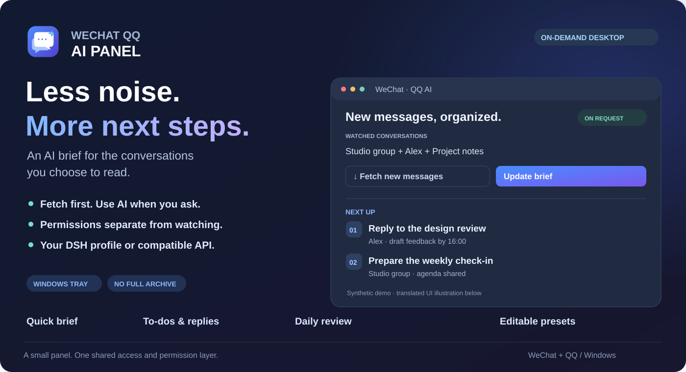
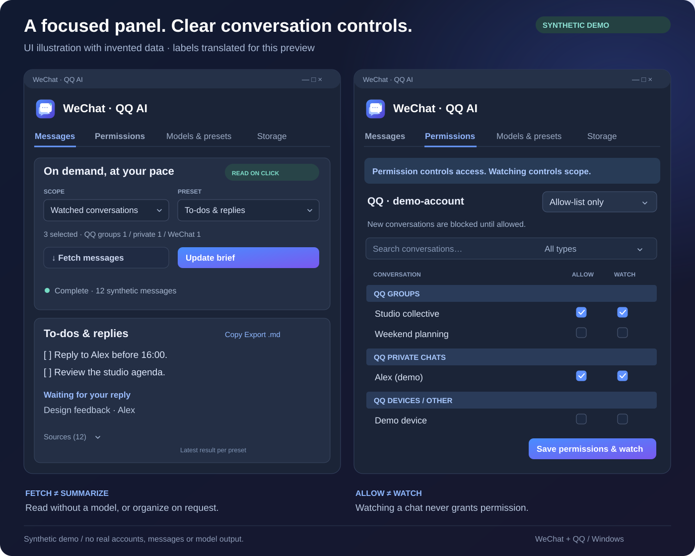

# WeChat QQ AI Panel

**An on-demand desktop brief for your existing conversations.** Fetch messages, summarize them and extract follow-ups in a small Windows tray panel, with editable prompts and a choice of DSH or a compatible API backend.

[简体中文](README.zh-CN.md) · [Access layer](https://github.com/Patr1ck2005/wechat-qq-access) · [Visual provenance](docs/visual-assets.md) · [History](docs/README-history.md)



## Interface preview



*Synthetic vector preview, not a live-account screenshot or a real model-run receipt. Names, counts, messages and results are invented. Relative-time annotations explain sorting and are not displayed by the app. The installed interface currently uses Chinese labels.*

| Read | Organize | Control |
|---|---|---|
| Fetch messages without a model | Quick brief, to-dos, replies and daily review | Per-account allow-list or exclusion-list |
| Group/private/device sections | Edit and save prompt presets | Watching never grants permission |

## Install

Requires Windows 10/11 x64, PowerShell 7, Python 3.11 and WebView2 Evergreen Runtime. Keep the repositories as siblings:

```powershell
mkdir wechat-qq-ai
cd wechat-qq-ai
git clone --branch v0.3.0 https://github.com/Patr1ck2005/wechat-qq-access.git access
git clone --branch v0.2.3 https://github.com/Patr1ck2005/wechat-qq-ai-panel.git panel
cd panel
./scripts/install.ps1
./scripts/start.ps1
```

The installer creates a separate panel environment, reuses the access deployment and creates the bundled-icon shortcut. QQ retains explicit network-exposure acknowledgement and manual login requirements. Private access data belongs to the selected deployment, normally `%USERPROFILE%/.local/share/wechat-qq-access` for new installations. See the [desktop entry](WEB_ENTRY.md) and [integration contract](INTEGRATION.md).

To refresh only an existing desktop shortcut and icon:

```powershell
./scripts/update-shortcut.ps1
```

Quit and reopen the panel to load updated window/tray icons. Existing configuration selection is preserved.

## First use

1. Prepare the message sources through the access project.
2. Set each account's conversation permissions. Allow-lists permit selected conversations; exclusion-lists permit all except excluded conversations, including new ones. Missing/invalid policy fails closed.
3. Select watched conversations within the authorized scope.
4. Choose backend and prompt. **Fetch** does not call a model; **Summarize** refreshes then analyzes; **Stop** cancels without advancing successful analysis cursors.

A local AI client can also discover and grant a precisely named conversation through the shared access skill. The panel is optional, and its revision-checked saves preserve intervening agent permission updates. Ambiguous names need clarification and existing-permissions-only requests never expand access.

DSH needs an installed distribution and configured provider. The panel uses a dedicated no-tools profile and private sessions, with no fallback to an unrestricted agent profile. API mode takes a full API base URL, exact model ID and environment-variable/Windows Credential Manager reference. No provider fallback is automatic; live compatibility depends on the chosen provider.

## Privacy and storage

The access layer checks stable platform/account/conversation identities before product reads and model submission. Authorized text goes to the selected provider; the same Windows user's other applications are outside this product boundary. A WeChat database shard may be decrypted locally before filtering; its cache remains in the access runtime. See [third-party notices](THIRD_PARTY.md).

Panel settings and latest results live under `%LOCALAPPDATA%/WeChatQQAIPanel`. DSH sessions can contain submitted text. Storage preview accounts for them separately; cleanup moves owned inactive files to Windows Recycle Bin. The panel does not create another complete chat archive. A failed deployment connection can write a bounded diagnostic without account IDs, message text or credentials.

## Development and license

```powershell
python -m unittest discover -s tests -v
```

Tests use synthetic messages and fake transports. Live GUI and DSH acceptance are operator-run and separate. This documentation update did not read chats, launch a model or run ingestion. Sending, automatic replies, continuous collection and GUI automation are outside scope.

Independent source and original artwork use [MIT](LICENSE). Upstream readers and dependencies retain separate terms, including the pinned NapCat non-commercial restrictions. [Visual assets](docs/visual-assets.md) documents the icon and synthetic previews.
